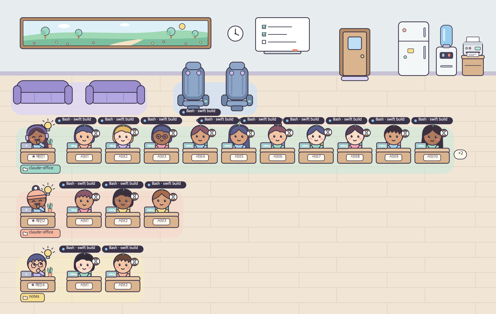

# Claude Office

Claude Code 세션과 서브에이전트가 일하는 모습을 **아기자기한 가상 사무실**로 보여 주는 macOS 메뉴바 앱입니다.

내가 연 세션은 **메인**으로, 그 메인이 띄운 세션과 서브에이전트는 **서브**로 출근해 메인마다 한 줄에 앉습니다. 누가 파일을 읽고 고치는지, 누가 내 승인을 기다리는지, 누가 일을 끝내고 쉬는지를 말풍선·표정·몸짓으로 알려 줍니다.



> Anthropic과 관계없는 개인 프로젝트입니다. 화면 글은 한국어만 있습니다.

## 이런 걸 할 수 있어요

- **사무실 창**: 세션마다 한 줄. 지금 하는 일이 머리 위 칩(`Bash · swift build`)으로, 승인 요청은 노란 말풍선("rm -rf build 해도 돼요?")으로 뜹니다. 일이 끝나면 소파·안마 의자에서 쉬다가 책상에서 잠듭니다.
- **미니 사무실**: 화면 구석의 작은 띠에 지금 가장 중요한 세션 하나(승인 대기 → 답변 필요 → 새 응답 순)만 보여 줍니다.
- **알림**: 승인을 기다리거나, 응답이 질문으로 끝나 내 답이 필요하면 macOS 알림. 누르면 그 세션으로 갑니다.
- **바로 가기**: 캐릭터를 더블클릭하면 Claude 데스크톱 앱의 그 세션 화면(또는 그 터미널)이 앞으로 옵니다.
- **현황 줄·인스펙터**: 누가 무엇을 했는지 최근 기록("12초 전 · Edit auth.ts").
- 밤 조명, 효과음, 동작 줄이기, VoiceOver·키보드 조작.

## 필요한 것

| | |
|---|---|
| macOS | **14 (Sonoma) 이상**, Apple 칩·인텔 모두 |
| Claude | **Claude 데스크톱 앱의 Code 탭**에 맞춰 만들었습니다. 터미널에서 연 `claude` 세션도 보입니다 |
| 빌드 도구 | **Xcode**(App Store, 무료)와 **XcodeGen**(`brew install xcodegen`) |

미리 빌드한 앱은 배포하지 않습니다. 자기 맥에서 소스로 빌드해 설치합니다 (Apple 개발자 계정 없이 만든 앱이라, 직접 빌드해야 macOS 보안 경고 없이 열립니다).

## 설치

Xcode와 XcodeGen이 준비되어 있으면 세 줄입니다.

```bash
git clone https://github.com/engyjoon/claude-office.git
```

```bash
cd claude-office
```

```bash
make install
```

몇 분 빌드한 뒤 `/Applications/Claude Office.app`에 설치됩니다.

처음이거나 막히면 **[docs/INSTALL.md](docs/INSTALL.md)**에 시작 전 확인, Xcode 준비, 문제 해결까지 자세히 있습니다.

> **Claude Code에게 맡기기:** 클론한 폴더에서 Claude Code를 열고 "이 앱 설치하는 거 도와줘"라고 하면, 이 저장소의 `CLAUDE.md`를 따라 설치 안내서를 읽고 한 단계씩 같이 진행합니다.

## 처음 쓰기

1. 앱을 엽니다. Dock에는 없고 **메뉴바에 아이콘**만 생깁니다.
   ```bash
   open "/Applications/Claude Office.app"
   ```
2. 알림 권한을 "허용"합니다.
3. 메뉴바 아이콘을 누르고 "Claude Code 훅이 설치되어 있지 않아요" 배너의 **설치**를 누릅니다.
4. Claude Code 세션을 **새로** 엽니다 (이미 열려 있던 세션은 훅을 다시 읽지 않습니다). Claude 데스크톱 앱에 열려 있는 세션은 앱을 켜자마자 자리에 앉아 쉬고 있습니다.
5. 메뉴바 아이콘 → **사무실 보기**로 사무실 창을 엽니다. 미니 사무실은 같은 메뉴에서 켜고 끕니다. **설정… → 연동 → 테스트 이벤트 보내기**로 가짜 직원이 출근했다 퇴근하는지 확인할 수 있습니다.

로그인할 때 자동으로 켜려면 **설정… → 일반 → 로그인 시 실행**을 켭니다.

## 앱이 내 맥에서 하는 일

- **훅 설치**: `~/.claude/hooks/claude-office.sh`를 쓰고, `~/.claude/settings.json`을 `settings.json.bak-날짜`로 백업한 뒤 Claude Office 훅만 추가합니다. 다른 설정은 건드리지 않고, **설정 → 연동 → 제거**로 그 훅만 뺍니다.
- **로컬에서만 통신**: 훅은 `curl`로 `127.0.0.1`의 앱에만 이벤트를 보내고, 앱은 실행할 때마다 새 토큰을 만들어 검사합니다. 외부 서버로 보내는 것은 없습니다.
- **데스크톱 앱 세션 읽기**: `~/Library/Application Support/Claude/claude-code-sessions/`의 세션 정보(제목, 폴더, 부모 세션)를 읽기만 합니다.
- 받은 이벤트는 메모리에만 두고, 디스크에는 설정과 캐릭터 외형만 저장합니다. 파일 이름이나 명령을 화면에 보이기 싫으면 **설정 → 표시 → 표시 수준**을 "요약"이나 "비공개"로 바꿉니다.

## 업데이트와 지우기

업데이트: 메뉴바 아이콘 → 종료한 뒤

```bash
git pull
```

```bash
make install
```

지우기: **설정 → 연동 → 제거**로 훅을 빼고, 로그인 시 실행을 끈 다음 앱을 종료하고

```bash
make uninstall
```

## 알아 둘 점

- Apple 개발자 서명·공증을 하지 않은 앱입니다. 직접 빌드하면 그냥 열리지만, 빌드한 앱을 다른 맥으로 옮기면 처음 열 때 막힙니다 ([INSTALL.md 부록](docs/INSTALL.md#부록-빌드한-앱을-옮겨-설치하기)).
- 같은 이유로 "로그인 시 실행"이 시스템 설정에서 따로 승인을 요구하거나, 다시 설치한 뒤 꺼질 수 있습니다.
- 회사에서 Claude Code 훅을 관리 설정으로 막아 두었다면 앱이 이벤트를 받을 수 없습니다.
- 데스크톱 앱의 세션 정보 파일과 세션 열기 링크는 공개 문서가 아니라서, Claude 데스크톱 앱이 바뀌면 일부 기능(미리 출근, 세션 화면으로 바로 가기)이 동작하지 않을 수 있습니다.

## 문서

- 다른 맥에 설치하기·문제 해결: [docs/INSTALL.md](docs/INSTALL.md)
- 설계서: [docs/DESIGN.md](docs/DESIGN.md)
- 스타일 미리보기: [docs/preview/index.html](docs/preview/index.html)
- 훅 페이로드 수집 안내 (M0): [docs/M0-capture.md](docs/M0-capture.md)
- 맥에서 빌드하고 확인하기 (M2): [docs/M2-build.md](docs/M2-build.md)

## 라이선스

[MIT 라이선스](LICENSE)입니다. 저작권 표시와 라이선스 문구를 함께 두면 누구나 자유롭게 쓰고, 고치고, 다시 배포할 수 있습니다. 아무 보증 없이 있는 그대로 제공합니다.

## 진행 상황

<details>
<summary>단계별 진행 기록 펼치기</summary>

| 단계 | 상태 |
|---|---|
| M0 준비: 실제 훅 수집 | 완료. Claude Code 2.1.318, 98건 (설계서 §4.1) |
| **M1 코어** (`OfficeCore`) | **완료**. 훅 파서, 사무실 상태, 연출 엔진, 대사, 효과음 합성 |
| M2 앱 뼈대 (메뉴바, 로컬 서버, 훅 설치) | 완료. 맥에서 실제 Claude Code 세션 확인 |
| M3 사무실 화면 (SpriteKit) | 완료. 맥에서 `make replay`로 출근·업무·퇴근 흐름 확인 ([장면 예시](docs/m3/)) |
| M4 표현 (말풍선 5종, 표정·제스처, 효과음) | 완료. 위임·승인 대기·완료 보고의 말풍선·상태 칩·표정·제스처·소리 ([장면 예시](docs/m4/)) |
| M4.5a 세션 판별과 직함 | 완료. 메인 세션 단위의 방, 팀장·파트장 직함(→ M4.5b에서 팀장·팀원N으로 바꿈), 팀장 퇴근 시 승진, 빈 방 정리, 워크트리 합침 (설계서 §5.1). 맥에서 실제 데스크톱 세션의 파트장1·2 표시 확인 |
| M4.5b 방 배치 | 완료. 왼쪽 위 팀장실(유리 칸막이·출입구) + 칸(팀장 칸·세션 팀원 칸, 빈 책상 빌리기, 줄 추가·축소), 직함을 팀장·팀원N으로 통일(에이전트 종류는 신원 카드에만), 팀장실 아래 휴게 공간·안마 의자, 창가 리서치 데스크, 서버랙 대신 자기 책상에서 긴 명령 대기(⏳)·탕비 코너, 말풍선·명패 칸 단위, 공용 구역 분산·칩 묶기, 맵 폭 1120 ([장면 예시](docs/m4.5/)) |
| M5(1) 행 배치와 디렉토리 선택 | 완료. 팀장·팀원 → 메인·서브(메인마다 서브 번호 따로), 메인마다 한 행(가장 왼쪽 메인, 오른쪽에 서브 책상 사람 수만큼, 빈 책상 없음, 언제나 3행까지), 공용 공간(3인용 소파 둘·안마 의자 둘, 정원 그림 액자, 탕비 코너·프린터 등)은 위쪽, 팀장실·칸·리서치 데스크·책장 제거, 사무실 배율 1 고정(넘치는 서브·메인은 숨기고 행 끝 "+N", 행 간격은 창 높이를 따름, 둘레 여백), 오른쪽 패널 위 **디렉토리** 드롭다운(Claude 데스크톱 앱에 열린 디렉토리 하나 또는 모두) + 아래 **세션** ([장면 예시](docs/m5/)). 맥 화면 확인은 사용자 몫 |
| M5(2) 실시간 현황 줄 | 완료. 사무실 바로 아래 한 줄: 캐릭터를 고르면 그 사람의 최근 도구 흐름(`메인1 Read 3개 → Edit auth.ts → Bash npm test (12초째)`, 같은 도구 묶기, 진행 중 경과 시간, 승인 대기 노랑·오류 빨강), 안 고르면 고른 디렉토리의 최근 일(`방금: 서브1이 auth.ts 편집 · 메인이 서브2에게 위임`, 조용하면 "모두 쉬는 중이에요"). 표시 수준이 요약·비공개면 파일명·명령을 숨기고 도구 종류만. 사무실 영역은 줄 높이를 빼고 그대로 배율 1·3행 (설계서 §10.2). 맥 화면 확인은 사용자 몫 |
| M5(3) 알림 | 완료. 승인 대기가 시작되면 macOS 알림 한 번(제목 "메인1 승인 대기", 부제 디렉토리, 본문 도구·명령 — 요약·비공개면 도구 종류만), 대기가 풀리면 알림 센터에서 지움. 응답 완료(Stop) 알림은 기본 끔. 알림을 누르면 데스크톱 앱 세션은 Claude 앱의 그 세션 화면(M5(7b)부터), CLI 세션은 그 터미널을 앞으로, 사무실 창이 열려 있으면 캐릭터 선택. 메뉴바 아이콘 상태 점(초록·노랑·회색)과 승인 대기 수, 설정 → 알림 탭, 집중 모드 중 알림 효과음 줄이기. `make notify-demo`로 확인. 맥 화면 확인은 사용자 몫 |
| M5(4) 미니 사무실 | 완료. 화면 오른쪽 아래 작은 패널(390×200, 디스플레이마다 위치 기억)에 메인 1명과 일하는 서브 2명을 사무실 그대로(배율 1) 보여 줌. 소파·안마 의자는 없고 쉬기는 책상에서. 보여 줄 메인은 내 답변이 필요한 세션(승인 대기·질문·계획 승인) → 응답을 끝낸 세션(10분, 미니를 눌러 확인) → 가장 마지막에 요청한 세션 순. 머리줄에 상태("✓ 응답 완료 · 1분 전" 등)와 다른 메인 칩. 미니를 누르면 미니는 숨고 사무실 창이 열림(캐릭터를 눌렀으면 그 사람을 고름). 사무실 창 도구 막대의 "미니 사무실로"(⇧⌘M)로 다시 미니로. 메뉴바·설정에서 켜기/끄기·투명도 (설계서 §10.1). 맥 화면 확인은 사용자 몫 |
| M5(5) 데스크톱 세션 미리 출근 | 완료. 앱을 켜면 Claude 데스크톱 앱에 열려 있는(보관하지 않은) 세션이 걸어 들어오지 않고 "쉬는 중"으로 바로 자리에 앉음(오래 쉬었으면 책상에서 잠든 채, 효과음·알림 없음). 띄운 세션은 그 메인의 서브. 메시지를 보내면 같은 캐릭터가 깨어나 일하고, 데스크톱 앱에서 보관하면 퇴근 (설계서 §5.2). 맥 화면 확인은 사용자 몫 |
| M5(6) 겹치지 않는 캐릭터 외형 | 완료. 사람이 많아져도 지금 사무실에 있는 사람끼리는 머리 모양·머리색·상의색·소품 중 2군데 이상 다른 얼굴(피부색만 다른 건 같은 얼굴로 봄). 같은 종류의 직접 만든 에이전트가 동시에 와도 다르고, 이미 있는 사람의 얼굴은 바뀌지 않으며, 다시 출근하면 대개 원래 얼굴 (설계서 §9.4). 맥 화면 확인은 사용자 몫 |
| M5(7) 인스펙터와 더블클릭 이동 | 완료. 캐릭터(또는 세션 패널 줄)를 누르면 뜨는 카드가 인스펙터로 넓어짐: 지금 하는 일(상태·경과 시간·세부), 메인이면 서브 목록(누르면 그 서브), 서브면 "메인1의 서브"(누르면 메인), 최근 일 타임라인("12초 전 · Edit auth.ts", 승인 대기 노랑·오류 빨강, 기본 3줄 → 모두 보기 15줄), [앱으로]/[터미널로]. 사무실 창·미니·세션 패널에서 캐릭터를 더블클릭하면 그 세션의 Claude 앱(그 세션 화면까지)이나 터미널이 앞으로(미니는 한 번 누르면 사무실 창, 두 번 누르면 미니는 그대로 두고 이동). 마우스를 올리면 도움말 (설계서 §10.3). 현황 줄에는 디렉토리가 "모두"일 때 어느 디렉토리 일인지 폴더 이름을 붙임(`claude-office · 서브1이 auth.ts 편집`, 설계서 §10.2). 맥 화면 확인은 사용자 몫 |
| M5(8) 설정 정리 | 완료. 설정 창을 일반·연동·표시·미니 사무실·알림·효과음 여섯 탭으로 정리(macOS 기본 설정 창 모습, 항목마다 짧은 설명). 일반: 로그인 시 실행(상태·승인 필요면 시스템 설정 열기), 버전, 사무실 창·미니 바로가기. 연동: 훅 상태(settings.json 등록, 스크립트, 서버 포트, 마지막 이벤트 "12초 전", 받은 이벤트 수), 다시 설치·제거(확인), 테스트 이벤트 보내기(가짜 세션이 잠깐 출근했다 퇴근, 알림 없음). 표시: 표시 수준, **동작 줄이기**(시스템 설정 따르기 + 항상 켜기, 켜면 걷지 않고 순간이동·제스처 생략), 오른쪽 패널. 메뉴바 "설정…"이 설정 창을 앞으로 가져옴. 바뀐 설정 키는 이어받음 (설계서 §10.4). 맥 화면 확인은 사용자 몫 |
| M5(9) 창 크기 고정, 현황 줄 세 줄 | 완료. 사무실 창 크기를 고정(사무실 3행 + 아래 현황 줄 + 오른쪽 패널, 가장자리 조절·최대화·전체 화면 막음, 패널을 숨기거나 보일 때만 너비가 바뀜, 화면이 작으면 화면 안에 맞게 줄임). 현황 줄을 세 줄로: 아무도 안 고르면 사무실의 행과 같은 순서로 행마다 한 줄(`● claude-office · 메인1 · 서브2가 Edit StaffPanel.swift (방금)`, 승인 대기 노랑, 조용하면 쉬는 중·잠든 중), 화면에 못 보여 준 행의 승인 대기는 "화면 밖" 알림 줄, 캐릭터를 고르면 그 사람의 최근 일 세 개. MCP 도구는 사람이 읽는 말("할 일 목록 정리"), 명령의 긴 경로는 마지막 이름(`cd claude-office`) (설계서 §10.2). 맥 화면 확인은 사용자 몫 |
| **M5 편의** | **완료** (M5(1)~M5(9)) |
| M6(1) 성능 측정과 최적화 | 완료. `make perf CASE=…`로 상황별 CPU·메모리를 재고(창 조작·격리 실행·바쁜 부하 스크립트 포함, 앱 안 계측은 기본 꺼짐), 도형을 구운 스프라이트로 바꾸고, 안 보이는 장면은 멈추고, 그리기 빈도를 움직임에 따라 30·10·6·3fps로 나눔. 메뉴바만 19.9 → 0.4%, 사무실 창 대기 43.9 → 1.6%, 최소화·가려짐 51 → 0.4%, 훅 → 화면 p95 80ms 이하 (설계서 §8.3). 쉬는 캐릭터가 자연스러운지 맥 화면 확인은 사용자 몫 |
| M6(3) 앱 아이콘 | 완료. 노란 둥근 사각형 바탕에 헤드폰을 쓰고 웃는 직원 얼굴(사무실과 같은 `CharacterArt` 도형). 16·32px 칸은 선을 굵게 하고 볼터치·별 배지를 뺀 그림. `make icon`이 `App/Assets.xcassets/AppIcon.appiconset`의 PNG를 다시 만듦 (설계서 §9.5). Finder·로그인 항목 확인은 사용자 몫 |
| M6(4) 답변 필요·확인 안 함 | 완료. 응답을 끝냈는데 **내 답이 필요한 세션**(질문·결정 요청으로 끝남)은 쉬러 가지 않고 자기 책상에서 머리 위 파란 "?"를 달고 기다리고, **아직 확인하지 않은 응답**은 소파·안마 의자·잠으로 쉬면서 머리 위에 ✉를 닮. 데스크톱 앱의 응답 요약과 그 세션을 연 때(`lastFocusedAt`), 응답 마지막 문장으로 판정하고, 그 세션을 보거나 새 요청을 보내거나 캐릭터를 누르면 풀림. 직원 현황("답변 필요"·"새 응답"), 현황 줄, 미니 사무실도 같은 순서 (설계서 §6.11). M6(4c): 답이 필요해지면 그 응답에 한 번 "메인1 답변 대기" 알림(기본 켬, 데스크톱 앱에서 그 세션을 보고 있으면 생략, 답하면 지움, 설정 → 알림 탭에서 끄기). 맥 화면 확인은 사용자 몫 |
| M6(5) MCP 도구 이름 | 완료. MCP 도구 이름이 보이는 모든 곳(머리 위 칩, 승인 대기 말풍선, 직원 패널·인스펙터·메뉴, 현황 줄·타임라인, 알림)이 같은 사전의 말을 씀: `MCP · Claude_Browser · navigate` → "브라우저 페이지 이동", `mcp__computer-use__app_click 해도…` → "화면 조작 써도 될까요?". 사전에 데스크톱 앱·브라우저·화면 조작·터미널·예약 작업·Docs 커넥터 등을 넣고, 모르는 서버는 이름을 띄어 쓰고(`my_server` → "my server"), UUID 커넥터는 "커넥터" (설계서 §10.2). 맥 화면 확인은 사용자 몫 |
| M6(6) 밤 조명 | 완료. 밤에는 사무실이 **저녁 조명**으로 바뀜: 벽·바닥·가구만 어둡게, 창밖은 밤하늘·별·초승달, 소파 옆 스탠드, **사람 있는 책상만** 스탠드와 화면 불빛. 직원·말풍선·칩·배지는 낮 색 그대로이고, 발밑 그림자는 옅은 빛 웅덩이, 상태 칩에는 옅은 테두리. 미니 사무실도 같고 평소 머리줄은 남색. 바뀔 때 0.6초 크로스페이드. 설정 → 일반 "사무실 조명": 시스템 모양 따라(기본) / 해 질 녘~새벽(19~7시) / 항상 낮 / 항상 밤. 대기 CPU는 그대로(미니 0.96%, 사무실 창 1.32%) (설계서 §8.2). `office-sim snapshot … --night`. 맥 화면 확인은 사용자 몫 |
| M6(7) 손쉬운 사용 | 완료. **VoiceOver**: 사무실·미니 장면의 캐릭터를 행 순서대로 "메인1, claude-office, 편집 중, Stage.swift"처럼 읽고(답변 필요·새 응답·승인 대기·정리 중, 행 끝 "+N"도), 누르면 고르고 동작 메뉴로 그 세션을 엶. 직원 패널·메뉴 줄은 한 문장, 상태 칩·현황 줄·인스펙터·디렉토리·미니 머리줄·메뉴바 아이콘(상태 점 대신 상태별 사람 수)에 라벨. 승인 대기·답변 필요가 생기면 한 번 안내(그 종류 알림이 켜져 있으면 알림이 대신). **키보드**: 사무실 창에서 ←→·Tab으로 직원 고르기, ↑↓ 옆 행, Return으로 그 세션, Esc로 풀기, 세션 목록은 ↑↓·Return, 메뉴에 ⌘O·⌘L·⌘,·⌘Q. **대비 증가**를 켜면 칩·배지·명패 테두리가 진해짐(밤 조명에서도) (설계서 §10.5). VoiceOver(⌘F5)·키보드 확인은 사용자 몫 |
| M6(16) 미니도 고른 디렉토리 안에서 | 완료. 사무실 창 디렉토리 드롭다운에서 디렉토리 하나를 고르면 미니 사무실도 그 디렉토리의 행만 후보로 삼아 같은 순서(답변 필요 "!" → "?" → 확인 안 한 응답 → 최근 요청 → 먼저 온 행)로 보여 줄 메인을 고름. 머리줄의 다른 메인 칩도 그 디렉토리 안만. 고른 디렉토리에 아무도 없으면 빈 띠에 "○○에는 출근한 직원이 없어요". "모두"면 예전과 같음. 드롭다운을 바꾸면 바로 다시 고름 (설계서 §10.1). 맥 화면 확인은 사용자 몫 |
| M6(17) 미니를 누르면 사무실 창을 맨 앞으로 | 완료. 미니를 눌렀을 때 사무실 창이 다른 앱 창 뒤에 열리던 문제를 고침: 앱을 확실히 활성화하고 창이 생길 때까지 몇 번 맨 앞으로 올림. 최소화돼 있으면 꺼내고, 다른 Space에 있으면 지금 Space로 데려옴. 메뉴바 "사무실 보기"·"이벤트 로그", 설정의 "사무실 창 열기", 미니 오른쪽 클릭 메뉴도 같음 (설계서 §10.1). 맥 화면 확인은 사용자 몫 |
| M6(18) 미니에서 디렉토리 바꾸기 | 완료. 미니 오른쪽 클릭 메뉴에 "디렉토리 ▸" 하위 메뉴: "모두"와 열린 디렉토리(사무실 창 드롭다운과 같은 문구 "claude-office · 메인 2 · 7명", 닫힌 디렉토리는 "(닫힘)"), 지금 고른 항목에 체크. 고르면 사무실 창과 미니가 함께 그 디렉토리로 바뀌고 미니는 바로 그 안에서 보여 줄 메인을 다시 고름. 직원 위에서 연 메뉴에도 나옴 (설계서 §10.1). 맥 화면 확인은 사용자 몫 |
| M6 다듬기 (직원 꾸미기) | 예정 |

</details>

## 개발

Swift 6 툴체인이 필요합니다. 코어는 Linux에서도 빌드하고 테스트할 수 있습니다.

```bash
make test
```

```bash
make demo
```

`make demo`는 `Scenarios/delegation.jsonl`(출근 → 위임 → 승인 대기 → 보고 → 휴식 → 퇴근)을 엔진에 넣고, 씬에 내려갈 지시를 시간 순서대로 출력합니다. `Scenarios/m0-observed.jsonl`은 실제 수집에서 관찰한 서브에이전트 패턴을 재현합니다.

```bash
make sounds
```

`make sounds`는 효과음을 `build/sounds/*.wav`로 저장하고, `make snapshot`은 말풍선까지 포함한 사무실 장면(위임 시나리오, 혼잡한 행 배치 `Scenarios/floor.jsonl`)을 `build/snapshots/*.svg`로 그립니다 (맥 없이 그림 확인, `office-sim snapshot … --size 1440x748`로 사무실 영역 크기 지정). 앱에서는 설정 → 효과음에서 항목별로 켜고 끄고 미리 들을 수 있습니다.

앱 아이콘 그림(`Sources/OfficeStage/Art/AppIconArt.swift`)을 고쳤다면 `make icon`으로 아이콘 PNG를 다시 만들어 함께 커밋합니다 (macOS에서만, `office-sim icon`이 SVG를 쓰고 `scripts/render-icon.swift`가 PNG로 그림).

맥 앱은 Xcode와 XcodeGen이 필요합니다 ([docs/M2-build.md](docs/M2-build.md)).

```bash
make run
```

`make serve`는 맥 앱 없이 훅 서버와 엔진만 실행하고(Linux 포함), `make replay`는 실행 중인 앱이나 serve로 시나리오를 보냅니다. `make notify-demo`는 알림 확인용 시나리오(승인 대기 → 응답 완료 → 질문으로 끝난 응답의 답변 대기, 약 1분 반)를 보냅니다.

## 구조

```
Sources/OfficeCore/   순수 Swift 코어 (훅 → 이벤트 → 사무실 상태 → 연출 지시, 효과음, 메뉴 목록, 현황 줄)
Sources/OfficeServer/ 로컬 훅 서버(BSD 소켓), 훅 스크립트, 훅 설치기 (macOS·Linux)
Sources/OfficeStage/  사무실 배치, 길찾기, 무대(연출 지시 실행·말풍선 규칙), 말풍선·칩 배치, 그림 데이터, SVG 렌더러
Sources/office-sim/   개발용 CLI (연출 타임라인, 효과음 WAV, 헤드리스 serve, replay)
App/                  macOS 메뉴바 앱 (SwiftUI, XcodeGen project.yml)
Tests/OfficeCoreTests 단위 테스트와 훅 픽스처
Scenarios/            office-sim 시나리오
scripts/              M0 훅 수집 도구
docs/                 설계서, 미리보기, 안내서
```
